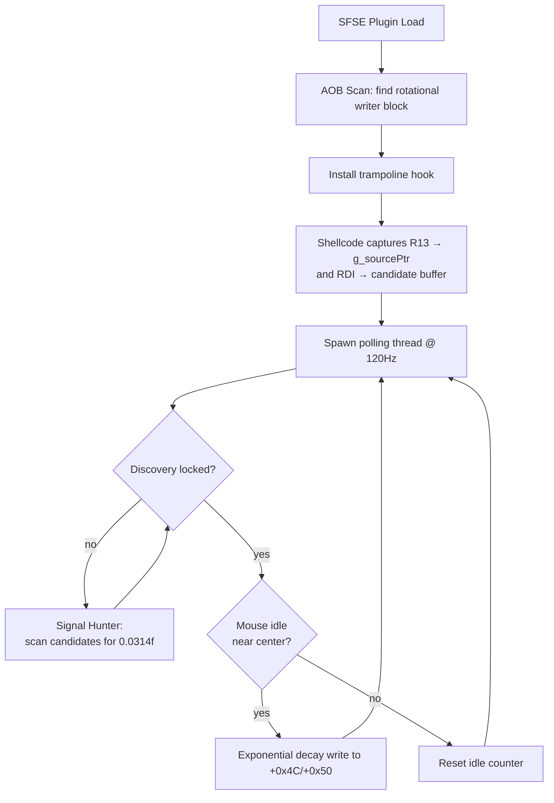

# Mouse Alignment Assist — Standalone Plugin Bootstrap

A minimal SFSE plugin that provides mouse centering/alignment assist for Starfield ship flight. No throttle injection, no joystick input, no binding wizard — just the decay logic observing the game's native mouse accumulator.

---

## Architecture Overview



### Two-Phase Discovery

The plugin uses a **data-driven signal hunter** rather than fragile AOB instruction scanning to find the ship control cluster. This is the same approach AbsoluteHOTAS uses and has survived every Starfield update since launch.

**Phase 1 — Hook Installation (one-time AOB scan):**
Find the rotational writer block to install a trampoline. This is the only AOB-dependent step, and the block is a large, distinctive 30-byte instruction sequence that has been stable across all known Starfield versions.

**Phase 2 — Signal Hunter (data-driven, version-independent):**
The user sets `fThrottleAtEngineStart = 0.0314` in `StarfieldCustom.ini`. When they board a ship, the game writes this sentinel value to the throttle memory lane. The hook's trampoline captures candidate pointers (RDI register) every frame. The polling thread scans each candidate for the magic float `0.0314f`. When found, discovery locks — the plugin now knows exactly where the control cluster lives.

The source object pointer (R13) is captured by the same trampoline. The mouse accumulator lives at `source+0x4C` (yaw) and `source+0x50` (pitch).

> [!TIP]
> **Why this is robust**: The sentinel approach is purely data-driven. It doesn't care about instruction encodings, register assignments, or code layout. As long as Starfield reads `fThrottleAtEngineStart` from the INI and writes it to the throttle memory lane (which it must, because it's a gameplay variable), the signal hunter finds it. This has worked unchanged across every Starfield patch since 1.7.x.

---

## Prerequisites

The user must add this to `Documents\My Games\Starfield\StarfieldCustom.ini`:

```ini
[Spaceship]
fThrottleAtEngineStart = 0.0314
```

This is the sentinel value the signal hunter looks for. Without it, discovery cannot lock.

---

## Step 1: SFSE Plugin Boilerplate

```cpp
#include <SFSE/SFSE.h>
#include <windows.h>
#include <thread>
#include <atomic>
#include <cmath>
#include <cstdio>

// ---- Globals ----
// Source object pointer (R13) — contains the mouse accumulator
static volatile uintptr_t g_sourcePtr = 0;

// Candidate buffer — RDI values captured by the hook
static constexpr int MAX_CANDIDATES = 256;
static volatile uintptr_t g_candidates[MAX_CANDIDATES] = {};
static volatile int g_candidateCount = 0;
static volatile bool g_captureEnabled = true;

// Discovery state
static volatile bool g_discoveryLocked = false;
static volatile uintptr_t g_activeThrottlePtr = 0;

// Config
static bool  g_enabled    = true;
static float g_radius     = 15.0f;
static int   g_idleMs     = 80;
static float g_decayRate  = 4.0f;
static int   g_pollRateHz = 120;
```

---

## Step 2: Hook Installation (AOB Scan for Writer Block)

The rotational writer block is the one AOB pattern we need. It's a 30-byte sequence:

```
49 8B 85 E8 01 00 00    mov rax,[r13+1E8]
48 8D 50 58             lea rdx,[rax+58]       ← HOOK SITE
C5 FA 11 02             vmovss [rdx],xmm0
C5 FA 11 52 04          vmovss [rdx+4],xmm2
C5 FA 11 58 60          vmovss [rdx+60],xmm3
C5 FA 11 48 64          vmovss [rdx+64],xmm1
```

We hook at `lea rdx,[rax+58]` (offset +7). The trampoline does three things:
1. Replays the original `lea` + clobbered `vmovss`
2. Stores R13 into `g_sourcePtr` (the source object)
3. Stores RDI into the candidate buffer (throttle pointer candidates)

```cpp
static uint8_t* AllocateNear(uintptr_t target) {
    for (uintptr_t addr = target - 0x70000000;
         addr < target + 0x70000000;
         addr += 0x10000) {
        void* mem = VirtualAlloc((void*)addr, 4096,
                                 MEM_COMMIT | MEM_RESERVE,
                                 PAGE_EXECUTE_READWRITE);
        if (mem) return (uint8_t*)mem;
    }
    return nullptr;
}

static uintptr_t ScanForWriterBlock() {
    HMODULE mod = GetModuleHandle(NULL);
    auto dos = (IMAGE_DOS_HEADER*)mod;
    auto nt  = (IMAGE_NT_HEADERS*)((uint8_t*)mod + dos->e_lfanew);
    auto sec = IMAGE_FIRST_SECTION(nt);

    uintptr_t textStart = 0;
    size_t textSize = 0;
    for (int i = 0; i < nt->FileHeader.NumberOfSections; i++) {
        if (memcmp(sec[i].Name, ".text", 5) == 0) {
            textStart = (uintptr_t)mod + sec[i].VirtualAddress;
            textSize  = sec[i].Misc.VirtualSize;
            break;
        }
    }
    if (!textStart) return 0;

    const uint8_t pattern[] = {
        0x49, 0x8B, 0x85, 0xE8, 0x01, 0x00, 0x00,
        0x48, 0x8D, 0x50, 0x58,
        0xC5, 0xFA, 0x11, 0x02,
        0xC5, 0xFA, 0x11, 0x52, 0x04,
        0xC5, 0xFA, 0x11, 0x58, 0x60,
        0xC5, 0xFA, 0x11, 0x48, 0x64
    };

    for (size_t i = 0; i + sizeof(pattern) < textSize; i++) {
        if (memcmp((void*)(textStart + i), pattern, sizeof(pattern)) == 0)
            return textStart + i;
    }
    return 0;
}
```

### Trampoline Shellcode

```cpp
static bool InstallHook() {
    uintptr_t blockAddr = ScanForWriterBlock();
    if (!blockAddr) return false;

    uintptr_t hookAddr = blockAddr + 7;  // lea rdx,[rax+58]
    uint8_t* tramp = AllocateNear(hookAddr);
    if (!tramp) return false;

    int idx = 0;

    // 1. Replay original: lea rdx,[rax+58]
    tramp[idx++] = 0x48; tramp[idx++] = 0x8D;
    tramp[idx++] = 0x50; tramp[idx++] = 0x58;

    // 2. Save RCX + flags
    tramp[idx++] = 0x51;  // push rcx
    tramp[idx++] = 0x9C;  // pushfq

    // 3. Capture R13 → g_sourcePtr
    tramp[idx++] = 0x48; tramp[idx++] = 0xB9;  // mov rcx, imm64
    uintptr_t srcAddr = (uintptr_t)&g_sourcePtr;
    memcpy(&tramp[idx], &srcAddr, 8); idx += 8;
    tramp[idx++] = 0x4C; tramp[idx++] = 0x89;
    tramp[idx++] = 0x29;  // mov [rcx], r13

    // 4. Capture RDI → candidate buffer (if capture enabled)
    //    Check g_captureEnabled first
    tramp[idx++] = 0x48; tramp[idx++] = 0xB9;  // mov rcx, &g_captureEnabled
    uintptr_t capAddr = (uintptr_t)&g_captureEnabled;
    memcpy(&tramp[idx], &capAddr, 8); idx += 8;
    tramp[idx++] = 0x80; tramp[idx++] = 0x39; tramp[idx++] = 0x00;  // cmp byte [rcx], 0
    tramp[idx++] = 0x74;  // je skip_capture
    int skipCapture = idx++;  // placeholder for relative offset

    // Store RDI into candidates[candidateCount]
    // Load candidateCount
    tramp[idx++] = 0x48; tramp[idx++] = 0xB9;  // mov rcx, &g_candidateCount
    uintptr_t cntAddr = (uintptr_t)&g_candidateCount;
    memcpy(&tramp[idx], &cntAddr, 8); idx += 8;
    tramp[idx++] = 0x8B; tramp[idx++] = 0x09;  // mov ecx, [rcx] (count)

    // Bounds check: if count >= MAX_CANDIDATES, skip
    tramp[idx++] = 0x81; tramp[idx++] = 0xF9;  // cmp ecx, MAX_CANDIDATES
    int32_t maxCand = MAX_CANDIDATES;
    memcpy(&tramp[idx], &maxCand, 4); idx += 4;
    tramp[idx++] = 0x7D;  // jge skip
    int skipFull = idx++;

    // candidates[count] = RDI
    tramp[idx++] = 0x48; tramp[idx++] = 0x8D; tramp[idx++] = 0x0C;
    tramp[idx++] = 0xCD;  // lea rcx, [rcx*8 + candidates]
    uintptr_t candBase = (uintptr_t)&g_candidates[0];
    memcpy(&tramp[idx], &candBase, 4); idx += 4;  // 32-bit disp
    // ... (simplified — in practice, use a mov abs approach like AbsoluteHOTAS)

    int skipLabel = idx;
    tramp[skipCapture] = (uint8_t)(skipLabel - skipCapture - 1);
    tramp[skipFull] = (uint8_t)(skipLabel - skipFull - 1);

    // 5. Restore flags + RCX
    tramp[idx++] = 0x9D;  // popfq
    tramp[idx++] = 0x59;  // pop rcx

    // 6. Replay clobbered: vmovss [rdx], xmm0
    tramp[idx++] = 0xC5; tramp[idx++] = 0xFA;
    tramp[idx++] = 0x11; tramp[idx++] = 0x02;

    // 7. JMP back to hookAddr + 8
    tramp[idx++] = 0xE9;
    int32_t jmpBack = (int32_t)((hookAddr + 8) - ((uintptr_t)&tramp[idx] + 4));
    memcpy(&tramp[idx], &jmpBack, 4); idx += 4;

    // Patch original site
    DWORD oldProt;
    VirtualProtect((void*)hookAddr, 5, PAGE_EXECUTE_READWRITE, &oldProt);
    uint8_t* site = (uint8_t*)hookAddr;
    site[0] = 0xE9;
    int32_t jmpToTramp = (int32_t)((uintptr_t)tramp - (hookAddr + 5));
    memcpy(&site[1], &jmpToTramp, 4);
    VirtualProtect((void*)hookAddr, 5, oldProt, &oldProt);

    return true;
}
```

> [!NOTE]
> The RDI candidate capture shellcode above is simplified. In AbsoluteHOTAS, this is done with absolute 64-bit addressing (`mov rcx, imm64`) for all pointer loads since the candidate array may be far from the hook site. See [ThrottleHook.cpp:L157-210](file:///c:/Users/jorda/OneDrive/Documents/Projects/AbsoluteHOTAS/projects/AbsoluteHOTAS/src/ThrottleHook.cpp#L157-L210) for the production shellcode.

---

## Step 3: Signal Hunter (Data-Driven Discovery)

This runs on the polling thread. It scans each candidate pointer for the magic sentinel value that the game writes from `StarfieldCustom.ini`.

```cpp
// SEH-safe float read — must be a standalone function
static float SafeReadFloat(uintptr_t addr) {
    __try { return *(volatile float*)(addr); }
    __except (EXCEPTION_EXECUTE_HANDLER) { return -999.0f; }
}

static void SafeWriteFloat(uintptr_t addr, float value) {
    __try { *(volatile float*)addr = value; }
    __except (EXCEPTION_EXECUTE_HANDLER) {}
}

static void SignalHunterTick() {
    if (g_discoveryLocked) return;

    int count = g_candidateCount;
    for (int i = 0; i < count && i < MAX_CANDIDATES; i++) {
        uintptr_t cand = g_candidates[i];
        if (!cand) continue;

        float memVal = SafeReadFloat(cand);

        // Check for the sentinel: fThrottleAtEngineStart = 0.0314
        if (std::abs(memVal - 0.0314f) < 0.0001f) {
            g_activeThrottlePtr = cand;
            g_discoveryLocked = true;
            g_captureEnabled = false;  // Stop capturing, we found it
            // Log success
            break;
        }
    }
}
```

> [!IMPORTANT]
> **Why 0.0314?** This value is set by the user in `StarfieldCustom.ini` under `[Spaceship] fThrottleAtEngineStart`. It's the throttle percentage the game applies when the player first boards a ship. Because it's an unusual float that no other game system would write to the same memory lane, it acts as a unique fingerprint. The signal hunter matches it to identify exactly which memory address is the throttle control cluster — completely independent of game code layout.

---

## Step 4: Decay Thread (Alignment Assist)

Once discovery locks, the thread switches from signal hunting to mouse observation + decay.

```cpp
static void PollThread() {
    float prevYaw   = 0.0f;
    float prevPitch = 0.0f;
    int   idleFrames = 0;
    auto  lastTime = std::chrono::steady_clock::now();

    while (true) {
        std::this_thread::sleep_for(
            std::chrono::microseconds(1000000 / g_pollRateHz));

        // Phase 1: Signal hunting (until discovery locks)
        if (!g_discoveryLocked) {
            SignalHunterTick();
            continue;
        }

        // Phase 2: Alignment assist
        if (!g_enabled) continue;

        uintptr_t src = g_sourcePtr;
        if (!src) continue;

        auto now = std::chrono::steady_clock::now();
        float dt = std::chrono::duration<float>(now - lastTime).count();
        dt = std::clamp(dt, 0.0001f, 0.1f);
        lastTime = now;

        float curYaw   = SafeReadFloat(src + 0x4C);
        float curPitch = SafeReadFloat(src + 0x50);

        constexpr float kEpsilon = 0.5f;
        bool moved = (std::abs(curYaw - prevYaw) > kEpsilon)
                  || (std::abs(curPitch - prevPitch) > kEpsilon);

        prevYaw   = curYaw;
        prevPitch = curPitch;

        if (moved) { idleFrames = 0; continue; }
        idleFrames++;

        int threshold = std::max(1, (g_pollRateHz * g_idleMs) / 1000);
        if (idleFrames < threshold) continue;

        float dist = std::sqrt(curYaw * curYaw + curPitch * curPitch);
        if (dist > g_radius || dist <= 0.1f) continue;

        float factor = std::exp(-g_decayRate * dt);
        float newYaw   = curYaw   * factor;
        float newPitch = curPitch * factor;

        if (std::abs(newYaw)   < 0.1f) newYaw   = 0.0f;
        if (std::abs(newPitch) < 0.1f) newPitch = 0.0f;

        SafeWriteFloat(src + 0x4C, newYaw);
        SafeWriteFloat(src + 0x50, newPitch);

        prevYaw   = newYaw;
        prevPitch = newPitch;
    }
}
```

---

## Memory Layout Reference

Once the signal hunter locks, the relevant pointers are:

| Global | Source | Content |
|--------|--------|---------|
| `g_activeThrottlePtr` | RDI from hook | Base of the throttle control cluster. The sentinel `0.0314f` is read from here. |
| `g_sourcePtr` | R13 from hook | Base of the source object. The mouse accumulator lives here. |

**Source object layout (from `g_sourcePtr`):**

| Offset | Type | Content |
|--------|------|---------|
| `+0x4C` | float | Mouse accumulator yaw (range ~-200 to +200) |
| `+0x50` | float | Mouse accumulator pitch (range ~-200 to +200) |

---

## INI Config

```ini
; MouseAlign.ini — place in Data\SFSE\Plugins\
[MouseAlign]
bEnabled = true
fRadius = 15.0          ; Accumulator units within which assist triggers (0-200)
iIdleMs = 80            ; Mouse idle time before decay starts
fDecayRate = 4.0        ; Exponential decay speed (higher = faster snap)
iPollRateHz = 120       ; Polling frequency
```

---

## Key Design Decisions

> [!IMPORTANT]
> **Signal Hunter > AOB Scan for discovery.** The AOB scan is only used once to find the trampoline hook site (the rotational writer block). The actual ship control cluster is found via the sentinel value — a purely data-driven approach that doesn't depend on instruction encodings and has been stable across every Starfield update since 1.7.x.

> [!WARNING]
> **SEH Restrictions**: `SafeReadFloat`/`SafeWriteFloat` must be standalone functions — they cannot be lambdas, inline, or inside any function that has C++ objects with destructors (e.g., `std::string`, `std::thread`). MSVC's `/EHsc` mode forbids mixing SEH with C++ unwinding.

> [!WARNING]
> **Pointer Lifetime**: `g_sourcePtr` is only valid while the player is in the pilot seat. SEH guards handle stale pointers gracefully. The hook fires every frame during flight, so the pointer auto-refreshes.

> [!NOTE]
> **Compatibility**: Do not load alongside AbsoluteHOTAS if its HOSAM mode is enabled — both would hook the same writer block. Check for `AbsoluteHOTAS.dll` at load time and bail out if present.

---

## Total Size

The complete standalone plugin is ~400 lines of C++. No DirectInput, no ImGui, no device polling. Just the hook, the signal hunter, and the decay thread.
